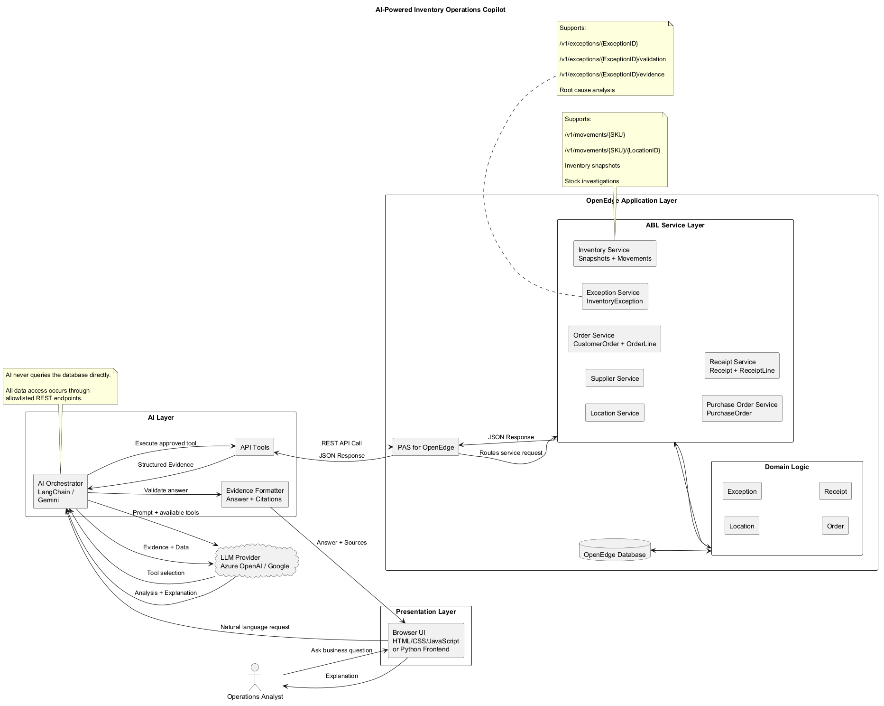
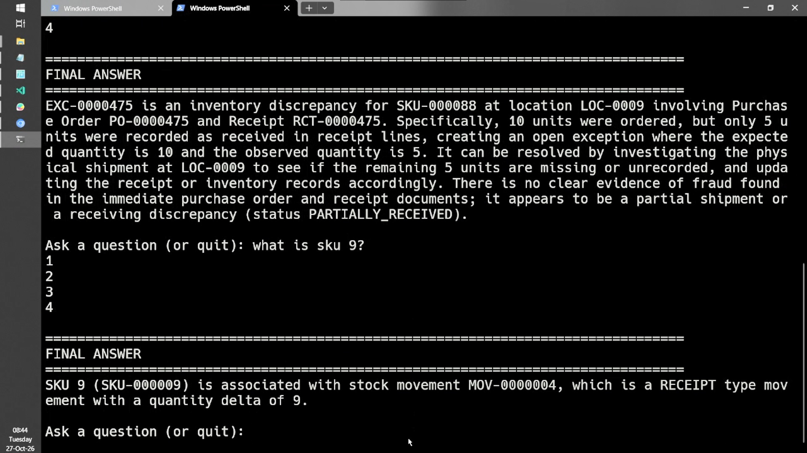

# Progress hackathon project

AI Powered Inventory Operations copilot is a natural language interface for inventory, purchasing, receiving and exception management workflows.

**Team**: Team lone wolf. **Members:** Brandon Sunguti. **Demo video**:`Demo/demo_video.mp4`

## Problem Statement

Organizations often store inventory data across multiple operational tables, screens, reports and applications.

Answering even simple questions may require personnel to manually:

- Search inventory records
- Review purchase orders
- Inspect receipts
- Analyze inventory movements
- Investigate exceptions
- Correlate multiple transactions

This process is:

- Time consuming
- Error prone
- Difficult for new users
- Dependent on specialist knowledge

The objective of this project is to reduce investigation time and improve operational visibility by allowing users to ask questions using natural language.

------------------------------------------------------------------------

## What was built

The system provides an AI driven investigation layer on top of OpenEdge business services.

Instead of manually navigating multiple application screens and systems, users can ask:

- Why does inventory exception 500 exist?

- Where is purchase order PO-12345?

- Why has customer order 987 not shipped?

- What inventory movements affected SKU ABC123?

The AI orchestrator retrieves the required information from approved REST endpoints and generates an explanation supported by source data.

---
### Inventory Visibility

#### Objective

Provide insight into inventory levels and stock movement activity.

#### Benefits

- Faster inventory analysis
- Reduced manual investigation
---

### Inventory Exception Investigation

#### Objective

Determine why inventory discrepancies occurred.

#### Benefits

- Faster root cause analysis
- Improved inventory accuracy

------------------------------------------------------------------------

### Purchase Order Tracking

#### Objective

Monitor purchase order lifecycle and receiving status.

#### Benefits

- Improved purchasing visibility
- Reduced follow up effort
- Faster supplier investigations

------------------------------------------------------------------------

### Receiving Verification

#### Objective

Validate received quantities against ordered quantities.

#### Benefits

- Improved receiving accuracy
- Faster discrepancy detection

------------------------------------------------------------------------

### Order Fulfillment Analysis

#### Objective

Understand customer order status and fulfillment issues.

#### Benefits

- Faster customer support
- Better order visibility
- Reduced fulfillment delays

------------------------------------------------------------------------

### Target Industries

This solution is intended for **Retail but** may be applicable to:

- Distribution
- Warehousing
- Logistics
- Manufacturing
- Supply Chain Operations

## How it works



## How to setup

### Prerequisites

- Python 3.11 - 3.14

- Progress OpenEdge 12.8

- PlantUML (for diagrams)

### Setup the Progress Application Server

- Start `proenv`

- Make a name for your PAS.

```         
set PASinstancename=htonPAS
```

### Create the PAS instance.

```         
pasman create -v -f %PASinstancename%
```

### Clone the repo

``` bash
git clone https://github.com/bbksu/progress_hackathon
```

### Import the project

- Start Progress Developer Studio.

- Go to File -\> Open Projects from File System -\> Import source -\> Directory -\> "..\\progress_hackathon\API"

- Click Finish

### Setup the server.

- Go to Window -\> Perspective -\> Open Perspective -\> OpenEdge Server.

- In OpenEdge Server Perspective -\> Click Server

- Create a new server -\> Progress Software Corporation -\> Progress Application Server for OpenEdge -\> Next -\> ABL Application "htonPAS" -\> Next.

- Add and Remove -\> Add all -\> Finish.

### Start the PAS server

- In OpenEdge Server Perspective.

- Right Click the PAS server instances -\> Start server or press `Ctrl + Alt + R`.

### Start the database server

- Start `proenv`

- Navigate to the database directory:

``` shell
cd "progress_hackathon/database/inventory"
```

- Start the database server for the `inventory` database:

``` shell
proserve inventory -H localhost -S 13000
```

### Connect the database

- In OpenEdge Server Perspective.

- Right Click the PAS server instance -\> Open -\> Click Open launch configuration -\> Databases -\> Configure Database connections -\> New

  - Connection Name: `htondb`

  - physical name: `..\progress_hackathon\database\inventory\inventory.db`

  - Hostname: `localhost`

  - Service/Port: `13000`

- Test Connection. -\> Next -\> Next -\> Next -\> Auto-Shutdown database server -\> Finish. -\> Apply and Close.

- In Edit launch configuration properties select `htondb`-\> Apply -\> OK.

- Right Click the PAS server instance -\> Restart.

### Install Python packages

``` shell
pip install -r frontend/requirements.txt
```

or

``` shell
python -m pip install -r frontend/requirements.txt
```

### Create a Gemini API Key

- Go to [Google AI Studio](https://aistudio.google.com/app/apikey) and log in with your Google account.

- Open the **API Keys** section from the dashboard menu.

- Click **Create API key.**

### Add environment variables

Copy your **API key and save it as** `GEMINI_API_KEY`, as an environment variable.

### Add PlantUML to PATH (Optional)

- Download [PlantUml](https://plantuml.com/download)

- Move the `plantuml.jar`to a directory like C:\\temp.

- Create a file called `plantuml.cmd`

- Add `java -jar C:temp/plantuml.jar $1`into `plantuml.cmd`

- Add `plantuml.cmd`to`PATH`

## How to Run the project

- Console only:

```         
python frontend/agent.py
```

- Browser only:
  - Browser mode supports diagrams showing.
  - Diagrams require PlantUML to be in path

``` shell
cd frontend
```

```         
python run_frontend.py
```

### Example prompts to try:

- Is SUP-0005 a good supplier?
- Why is EXC-0000081 giving us problems?
- Why is EXC-0000475 such an issue? And can it be resolved? And is there possibly some fraud happening?
- What is happening with EXC-0000039? Can you show a mapping of it to make it clear?
- What does PurchaseOrder PO-0000014 look like as a diagram?
- Can you lookup 2 random EXC and see which have Values above 50?
- Can you look at the first 4 suppliers and order them by the fastest?
- Can you give me therapy if EXC-0000081 is a problem?
- give me details about the 2nd and 4th orders including what was purchased

## Demo

[](https://github.com/bbksu/progress_hackathon/raw/refs/heads/master/Demo/demo_video.mp4)

### Challenges and learnings.

#### Challenges

- Connecting PAS and database.

- Troubleshooting tomcat server and OpenEdge explorer.

#### Learning

- ABL syntax.

- ABL services with the WEB transport

- How to use OpenEdge Dictionary.

### What needs Improvement.

- Manipulate strings

- Working with lists

- Working with Posts using JSON objects.

## What's next